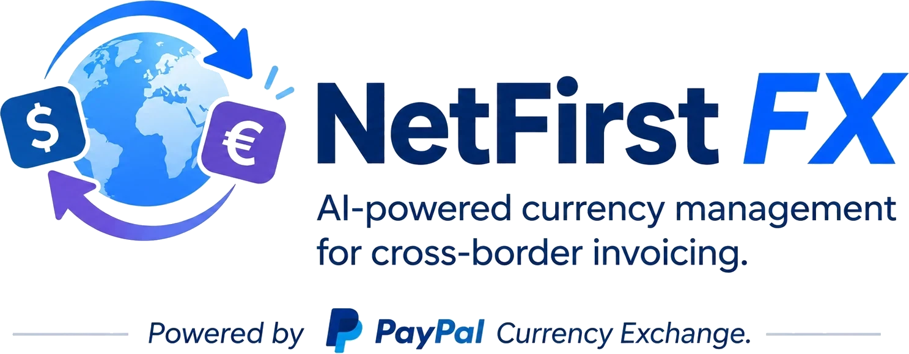
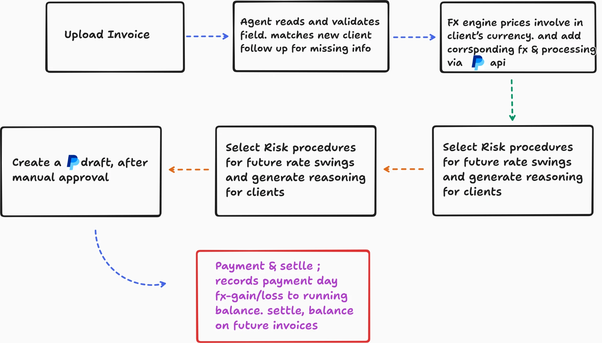

<p align="center">
  
</p>

<p align="center"><b>Invoice in any currency. Get paid what you actually charged.</b></p>

<p align="center">
  
  
  
  
  
  
  <br>
  
  
  
  
  
  
  <br>
  
  
  
  
</p>

---

## The problem

Every cross-border PayPal invoice quietly loses **7–9%** to receiving fees and conversion markup. Freelancers pad prices with a guessed 3–5% buffer, overcharging some clients, undercharging others, and never knowing which.

## The solution

**NetFirst FX** is an AI invoicing agent built on PayPal. Drop in the invoice PDF you already make, and it:

- **Charges the real FX cost** as a visible line, priced with PayPal's live exchange rate.
- **Tracks every rate swing** between sending and payment, per client.
- **Nets gains and losses** on a running balance that settles in one small invoice, not on every bill.

The AI reads, decides and explains. Plain code does every calculation and every PayPal call. Nothing goes out without your approval.

## How it works

<p align="center">
  
</p>

## One rule per client

| Treatment | FX cost | Rate swing | Best for |
|---|---|---|---|
| **Charge** | Billed on the invoice | Absorbed | New or slow-paying clients |
| **True-Up** | Billed on the invoice | Netted on the client's balance | Repeat clients |
| **Defer** | Carried to the balance | Carried to the balance | Loyal clients, under a cap |

The agent picks the treatment from payment history. Balances over the cap become **one settlement invoice**; credits become **a discount on the next one**.

## See it live

The guided demo runs four real invoices end to end, each with a step-by-step tour:

https://dc171pyg4k4gz.cloudfront.net/

<br>

| Scenario | Client | Invoice | What you see |
|---|---|---|---|
| Charge | Marks & Spencer | GBP 465.82 | FX line billed upfront |
| True-Up | Apple Green Ltd | GBP 817.64 | Past credit returned as a discount |
| Defer | Eurotech GmbH | EUR 1,200.00 | Clean invoice, FX carried forward |
| Settlement | Global Freight Co | USD 2,100.00 | Cap reached, settlement proposed |

Each run goes **upload → agent works → review → send and collect → ledger impact**, then opens the same invoice in AG Grid analytics and in your live PayPal invoices. Every visitor gets a private, freshly seeded workspace.

## Built on PayPal

| API | Used for |
|---|---|
| Invoicing v2 | Drafts with the FX line, sending, payer links, credit discounts, settlement invoices |
| Currency Exchange | Live locked rates (`/v2/pricing/quote-exchange-rates`), ECB as fallback |
| Webhooks | `INVOICING.INVOICE.PAID` posts the payment-day true-up |

## Architecture


## Get started

**You need:** Python 3.13 + [uv](https://docs.astral.sh/uv/), Node.js 20+, a [PayPal sandbox](https://developer.paypal.com) app with Invoicing enabled, and a [Groq](https://console.groq.com) API key.

**1. Configure**

```bash
cp netfirst/.env.example netfirst/.env
```

Set `PAYPAL_CLIENT_ID`, `PAYPAL_CLIENT_SECRET`, `GROQ_API_KEY` and `DEMO_MODE=1`. In `hackathon-paypal-ag-grid-boilerplate/.env.local`, add your AG Studio licence key, the same PayPal credentials and `NETFIRST_API_URL=http://localhost:8000`.

**2. Run the three services**

```bash
cd netfirst/api && uv sync && uv run uvicorn app.main:app --port 8000
```

```bash
cd hackathon-paypal-ag-grid-boilerplate && npm install && npm run dev -- --port 3001
```

```bash
cd netfirst/web && npm install && npm run dev
```

**3. Open http://localhost:3000.** That's the only URL you need: it routes `/api` and `/analytics` behind the scenes.

Run the tests with `cd netfirst/api && uv run pytest`.

## Deploy to AWS

All three services run in one ECS Fargate task behind an ALB and CloudFront, with SQLite on EFS and secrets in Secrets Manager.

```bash
bash scripts/push-secrets.sh   # upload .env values to Secrets Manager
bash scripts/infra-setup.sh    # create ECR, EFS, IAM, ALB, ECS, CloudFront
bash scripts/build-push.sh     # build and push the three images
bash scripts/deploy.sh         # start the service
```

For later code changes, run `build-push.sh` and redeploy the `netfirst-demo` service.

## Project layout

```
netfirst/api/                          FastAPI backend: agent, FX engine, ledger, PayPal client
netfirst/web/                          Next.js app: landing, scenarios, guided tours
hackathon-paypal-ag-grid-boilerplate/  AG Grid analytics console
scripts/                               AWS deployment
```

## License

MIT. See [LICENSE](netfirst/LICENSE).

## Team Nooglers


- [@Sai Nivedh V](https://github.com/SaiNivedh26)
- [@Baranidharan S](https://github.com/thespectacular314)
- [@Roshan T](https://github.com/Git-Roshan09)
- [@Hari Heman](https://github.com/MAD-MAN-HEMAN)


